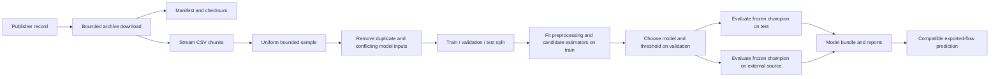

# Architecture and feature contract

## Implemented research path

| Module | Responsibility |
|---|---|
| `datasets.py` | Publisher locators, bounded transfer, archive validation, provenance |
| `data.py` | Single feature allowlist, numeric coercion, sampling, deduplication, EDA |
| `training.py` | Resource monitor, split isolation, estimators, selection, bundle and reports |
| `evaluation.py` | Binary metrics, operating-point constraints, attack-family recall |
| `inference.py` | Trusted artifact loading, schema checks and atomic batched prediction |
| `hardware.py` | Nonprivileged CPU/RAM/disk inventory |
| `cli.py` | Explicit, scriptable command interface and nonzero failure exits |
| `provenance.py` | Header-only source metadata inspection and declared capture/time/host plan validation |
| `measurement.py` | Bounded Linux offline NFStream adapter, separate measurement contract and fixture comparisons |

## Contract version `uq-netflow-v2-numeric-1`

The contract contains 40 numeric features from UQ extended NetFlow v2, listed in one place in
`src/netattdetector/data.py`. It excludes source/destination addresses, `DNS_QUERY_ID`, binary
`Label`, text `Attack`, dataset identifiers, and every undeclared column. Ports and TTLs remain
research inputs; removing them is an explicit ablation story because they can encode testbed
identity. Binary mapping is `0=benign`, `1=attack`. Attack names are evaluation metadata only.

Data is cast to float32 before fingerprinting/model use; nonnumeric/nonfinite values become
missing. Float32 reduces memory and intentionally loses some high-integer precision. Fingerprints
therefore identify equality of the **model representation**, not byte-identical source records.
64-bit row hashes have a small collision risk and are not cryptographic identity proofs. Median
imputation and zero-variance removal fit only on training. SGD also learns a training scaler.
Absent feature columns fail; missing individual values do not acquire fabricated packet meanings.

All candidates expose attack scores through the same preprocessing pipeline. Balanced weighting
is used for SGD, histogram boosting, and Extra Trees; XGBoost starts without reweighting as a
separate baseline. No global SMOTE, no preprocessing fitted on a test set, and no arbitrary
cross-source feature substitution is used.

The artifact contains the pipeline, ordered feature names, binary mapping, schema version,
chosen threshold and training configuration. The adjacent metrics report records dependency
versions and data hashes. Pin the lockfile and Python for reproduction. joblib compatibility
across dependency versions is not guaranteed; load trusted artifacts in the recorded environment.

## Future live architecture — not implemented

Authorized sensor → bounded bidirectional flow exporter → schema/units validation → batched
classifier → event deduplication and rule correlation → analyst queue → labeled feedback.

The [offline measurement lab](../guides/MEASUREMENTS.md) now verifies selected native NFStream
counters/durations on controlled fixtures. This is not a live sensor or a replacement training
contract for existing models. `nfstream-core-v1` remains incompatible with the UQ contract.

Choose a maintained exporter after validating feature parity. UQ NetFlow fields are not a drop-in
replacement for Zeek `conn.log`, CICFlowMeter features, or PyShark packet attributes. Either use
the same compatible exporter/configuration as the benchmark, or build a new training dataset
with the chosen exporter and version a new contract. Timeout, flow direction, retransmission
definitions, TCP close behavior, IPv6 and sampling must all be documented and tested with PCAP
fixtures. Missing exporter-only fields require a separately trained reduced model, not zero fill.

A later FastAPI service can wrap batch prediction after authentication, request bounds,
backpressure, process limits and telemetry are designed. Add containers and ONNX only after a
measured need; conversion must preserve threshold decisions. A dashboard is useful after alert
semantics and investigation context exist. Kafka, Kubernetes, GPUs, and deep models are not
initial dependencies because this workload does not yet justify their operational cost.

The first pilot runs in shadow mode. Model output does not block traffic. Alerts need evidence,
sensor/version/time metadata, duplicate suppression and analyst review. Privacy-sensitive flow
metadata stays local unless the operator explicitly configures a destination and retention policy.
