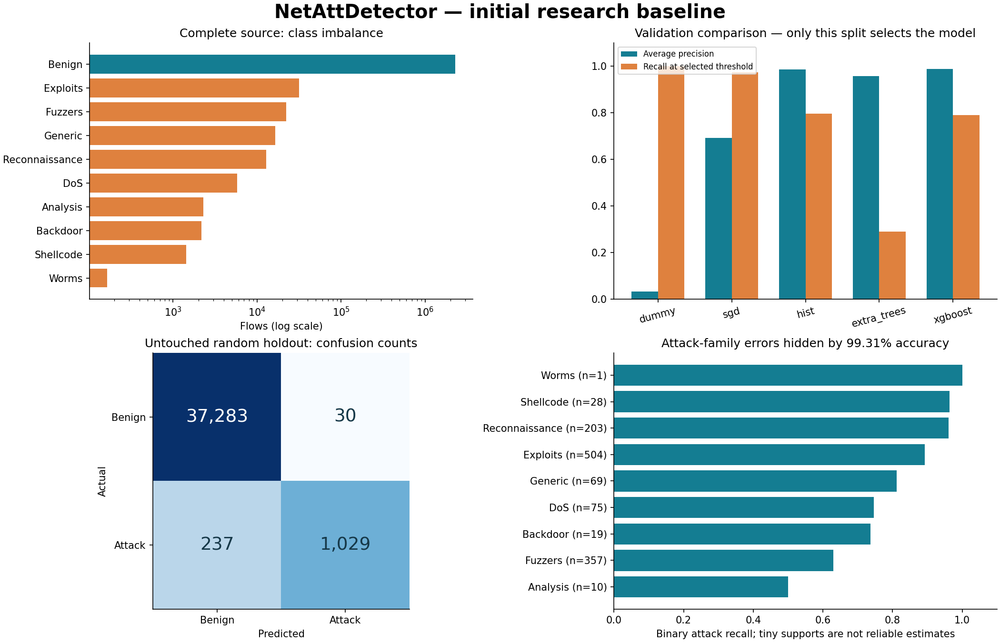

# Initial research baseline and model card

Evaluation date: 29 October 2026. This file is updated with verified experiment evidence below.

## Intended use and limits

The model is a binary research classifier for compatible UQ extended NetFlow v2 exports.
It is not validated for arbitrary packet captures, a different exporter, zero-day attack detection,
automated blocking, or commercial deployment. Do not use legacy 100% scores as a comparison.

The first local result uses a uniform capped sample, sample-level deduplication and a 60/20/20
stratified random split. Model and threshold were chosen only on validation. Random splitting
does not establish generalization across capture sessions, devices, time or deployment sites.
Any external failure is reported alongside the in-domain result. Detailed results and acquisition
records are appended once the corresponding runs finish.

**Release assessment: do not deploy this champion.** The independent-source test below exposes
severe transfer failure. The in-domain accuracy is not evidence of real-world readiness.

## Local experiment

Command:

```powershell
uv run --no-sync netatt train --data data/raw/nf-unsw-nb15-v2.zip --config configs/benchmark.json --output artifacts/baseline-local
```

The full input scan verified 2,390,275 rows: 2,295,222 benign and 95,053 attacks, with no invalid
binary labels. Uniform sampling retained 200,000; duplicate removal excluded 7,109, leaving
192,891 flows. No conflicting binary feature rows occurred within this sample. Final prevalence
was 3.28% attacks, compared with 3.98% in the full input. That difference must be preserved in
interpretation. Splits were 115,734 training, 38,578 validation, and 38,579 test flows.

| Candidate | Validation precision | Validation recall | Average precision | Constraints met | Fit time (s) |
|---|---:|---:|---:|---|---:|
| Dummy | 3.28% | 100.00% | 0.03282 | No | 0.60 |
| SGD logistic | 76.24% | 97.31% | 0.69278 | No | 2.04 |
| Histogram boosting | 98.05% | 79.62% | 0.98570 | Yes | 16.39 |
| Extra Trees | 98.13% | 28.99% | 0.95737 | Yes | 4.90 |
| XGBoost | 98.04% | 79.07% | 0.98753 | Yes | 4.46 |

Histogram boosting won under the documented recall-with-constraints rule; XGBoost had a
slightly higher ranking score (average precision) but lower recall at its selected operating point.
The stored histogram threshold is `0.9957466410915312`. Scores are not calibrated probabilities.

| Final random holdout | Value |
|---|---:|
| Accuracy | 99.3079% |
| Attack precision | 97.1671% |
| Attack recall | 81.2796% |
| Attack F1 | 0.88516 |
| Macro F1 | 0.94080 |
| Average precision | 0.98012 |
| ROC AUC | 0.99946 |
| Benign FPR | 0.08040% |
| False alarms / 10,000 benign flows | 8.04 |
| True negatives / false positives | 37,283 / 30 |
| True positives / false negatives | 1,029 / 237 |

**The 98% precision target failed on test.** Accuracy above 99% hides 237 missed attacks.
Analysis recall was 50% (10 examples), Fuzzers 63.0% (357), Backdoor 73.7% (19), and DoS
74.7% (75). Worms recall was 100% on just one example, which does not establish reliable worm
detection. Minority support and the random split prevent strong production claims.

The complete local run took 60.13 seconds, with sampled peak process RSS 347.2 MiB.
The selected compressed bundle is 103,065 bytes. Warm 2048-row inference batches had median
11.32 ms and p95 13.87 ms across seven repetitions. These timings exclude CSV parsing, model
load and live export, and do not measure network capture capacity. They demonstrate that the
first benchmark is practical on the audited CPU, not an end-to-end production throughput claim.

Environment: Python 3.13.5, NumPy 2.5.4, pandas 2.3.3, scikit-learn 1.9.1, joblib 1.6.0,
psutil 7.2.2, XGBoost 3.4.1. The lockfile records the full environment. This run occurred during
development and correctly records a dirty worktree based on original revision `f1b2d59`.
The finalized source is reviewed in the modernization branch; the remote run supplies a clean
commit-bound reproduction. Model selection has not been changed in response to the test result.



Machine-readable evidence: [metrics](evidence/local-metrics.json),
[data profile](evidence/local-data-profile.json),
[download manifest](evidence/nf-unsw-nb15-v2.manifest.json).

## Independent-source evaluation of the saved local champion

Evaluated the already saved local model against NF-ToN-IoT-v2 without refitting any preprocessing,
retraining the classifier, changing its threshold, or choosing a different candidate. The reference
archive checksum was verified and its original seeded cohort regenerated for overlap checks.

The complete second CSV contained 16,940,496 flows: 6,099,469 benign and 10,841,027 attack.
The capped 200,000-row sample had two feature-equivalent rows with conflicting binary labels;
both were excluded, along with 5,707 repeated feature rows. The remaining 194,291 flows had
zero feature-hash overlap with the in-domain cohort. Labels were valid throughout the full scan.

| Metric | In-domain random test | External ToN-IoT sample |
|---|---:|---:|
| Evaluated flows | 38,579 | 194,291 |
| Attack prevalence | 3.28% | 63.52% |
| Accuracy | 99.31% | 36.19% |
| Attack precision | 97.17% | 29.94% |
| Attack recall | 81.28% | **0.3314%** |
| Average precision | 0.9801 | 0.5737 |
| ROC AUC | 0.9995 | 0.3342 |
| Benign FPR | 0.0804% | **1.3503%** |
| False alarms / 10,000 benign flows | 8.04 | 135.03 |

External confusion counts: 69,914 TN, 957 FP, 123,011 FN and 409 TP. Backdoor and ransomware
had zero detected attacks in this sample; scanning, DDoS and DoS recall were also near zero.
The external average precision is below its 0.6352 attack-prevalence baseline. This is not just
a reassuringly high-ranking model with an inconvenient operating point.

This demonstrates transfer failure under the stated protocol. It does **not** identify a single
cause. Traffic/attack distribution differences, source-specific feature-label shortcuts, export
semantics and label quality all require investigation. Shared feature names do not establish
deployment compatibility. Do not lower the threshold using this test and report a new independent
test success; that would turn the external source into development data.

External evaluation took 210.91 seconds including the reference rescan and complete second
source scan. Sampled peak process RSS was 342.1 MiB. The local model was unchanged.

Machine-readable evidence: [external metrics, profile and slices](evidence/external-local.json),
[second download manifest](evidence/nf-ton-iot-v2.manifest.json).
The two archives total 201,997,602 bytes (192.64 MiB compressed) and 19,330,771 verified flows.
Their data CSVs total about 3.12 GB uncompressed and remain compressed on disk.

## Next experiment decision

Keep this model as a reproducible baseline. Prioritize global conflict/duplicate checks,
source/capture-aware splits, feature distribution and port/TTL/application-ID ablations, then
development across multiple sources. Establish a **new** untouched source or local capture for
evaluation before adapting to UNSW and ToN together. Tune and calibrate within development
data; gate any next candidate on minority recall, uncertainty, local false alarms and exporter
parity. A larger merged dataset or a neural network is not by itself a remedy.
