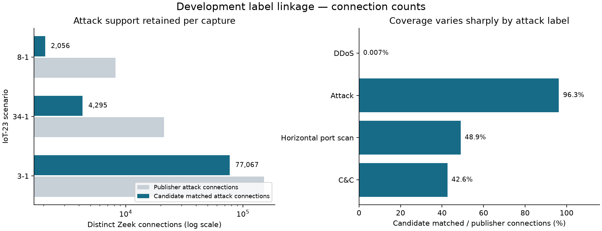

# Expanded development captures and bounded label indexing

Measured 31 October 2026. **Three new complete bundles are local and verified; all pass the
connection-support and resource screens.** They provide 83,418 distinct candidate-matched
attack connections, compared with 21 in the first three captures. Label coverage remains
selective, so this is preparation for a new benchmark. Training stays disabled.

## Inputs and reproducibility

This sprint builds on PR #6 at `eecc0b0`. Registered scenarios 8-1, 34-1 and 3-1 in development
configuration commits `e6e597a` and `95855ed`, before acquiring their bytes or label logs. Selection
used publisher sizes and class tables after observing sparse support in 20/21/42. This is
adaptive development. CICIDS2017 remains reserved/unacquired and CSE remains observed evaluation.

All nine new files are pinned by observed SHA-256: **215,084,316 bytes** including PCAPs, label
logs and READMEs. They are downloaded on this Windows laptop and verified against cloud inputs.
The [local inventory](evidence/capture-expansion/local/acquisition.json) records actual directories;
retry directories were needed during interrupted/slow downloads. The PCAPs total 186,336,114
bytes. No full multi-gigabyte collection, malware binary or private network traffic was acquired.

The [registered protocol](../docs/research/CAPTURE_EXPANSION.md) keeps the original profile's
limits and adds an explicit expansion profile: 128 MiB PCAP, 32 MiB label log, 250,000 labels
and a 250,000-flow stop. Downloads stream/hash in at most 64 KiB reads. The expanded profile
allows a 1,200-second download deadline after a 300-second local transfer timed out; its audit
screen still requires under ten minutes and sampled process-tree RSS sum below 1 GiB/capture.

Run [41239527703](https://github.com/LahsenAitOiahmane/NetAttDetector/actions/runs/41239527703)
at `70c22da` completed pinned acquisition, all three SQLite audits, fixture checks and a fresh-process
index comparison. Saved [configuration and aggregate evidence](evidence/capture-expansion/expanded/summary.json)
contain no connection rows, raw packet data or private indexes. Earlier successful expanded runs
at `a155d10` and `1b2556a` produced the same linkage counts; timings vary between runs.

## Measured support and coverage

| Scenario / publisher description | Exported flows | Candidate-matched flows | Distinct matched benign / attack connections | Audit seconds | Sampled tree RSS sum MiB |
|---|---:|---:|---:|---:|---:|
| 8-1 / Hakai | 12,459 | 5,662 | 1,550 / 2,056 | 1.82 | 150.4 |
| 34-1 / Mirai | 13,972 | 9,549 | 243 / 4,295 | 3.31 | 153.7 |
| 3-1 / Muhstik | 224,388 | 146,738 | 2,818 / 77,067 | 35.47 | 274.1 |
| Total | 250,819 | 161,949 | 4,611 / 83,418 | 40.61 | — |

These are label-linkage counts. One Zeek UID can produce multiple NFStream timeout segments;
all such segments must stay together in any later split. Distinct UIDs still do not establish
independent attacks, independent devices or a representative deployment distribution.

| Publisher attack detail | Publisher connections | Candidate-matched connections | Connection coverage |
|---|---:|---:|---:|
| C&C | 14,936 | 6,358 | 42.6% |
| Horizontal port scan | 145,719 | 71,317 | 48.9% |
| Attack | 5,962 | 5,742 | 96.3% |
| DDoS | 14,394 | 1 | 0.007% |

This makes a remaining label problem explicit: almost all DDoS connections are excluded.
The 34-1 log has 16,904 malicious records without durations; 8-1 has 6,166 and 3-1 has 72,947.
The current rule retains unknown ends as blockers rather than inventing intervals.
An additional [publisher-log check](evidence/capture-expansion/missing-duration-by-detail.json)
counts 14,381 missing DDoS durations out of 14,394, making the coverage failure directly auditable.
The new candidate subset is heavily attack-skewed: 156,372 of 161,949 matched segments are attacks.
An always-attack decision would appear 96.6% accurate on that subset while flagging every benign
segment. This is arithmetic from label counts, not a trained-model result or a deployment estimate.

The matcher continues to require an orientation-independent TCP/UDP tuple and one containing
label interval, with one millisecond of quantization tolerance. Ambiguous, missing-duration,
partial, unsupported and unmatched flows remain unlabelled. No whole-capture attack labels,
nearest-time guesses or benign defaults were added to increase coverage.

## Optimized indexing and actual parity evidence

SQLite stores exact int64 nanoseconds and tuple/time lookup keys with an 8 MiB cache and a
512 MiB main-file cap. The largest actual index was 31,211,520 bytes. Each query fetches at
most two overlapping candidates; two already make a match ambiguous. Original and expanded
input limits are explicit; main-file caps exclude journals/temp files, and identity/UID sets
remain bounded in memory by the configured flow/label limits.

The [fresh-process comparison](evidence/capture-expansion/expanded/index-comparison/comparison.json)
used the largest capture, 3-1, once per backend with identical input hashes/settings. All counts
and the ordered flow/status/UID/label assignment SHA-256 agreed.

| Backend | Audit seconds | Sampled parent RSS MiB | Sampled parent/child RSS sum MiB |
|---|---:|---:|---:|
| In-memory reference | 25.28 | 271.0 | 436.6 |
| SQLite | 24.20 | 173.8 | 245.7 |

SQLite used **43.7% less sampled process-tree RSS sum** and 35.9% less parent RSS in this
comparison. One run per mode is insufficient to establish a speed improvement or universal
memory saving. Samples are taken every 50 ms, can miss brief peaks and can count shared pages
multiple times. This covers parsing/imports/indexing/iteration/matching/cleanup, excludes
downloads and is not a live overload/loss benchmark or an OS-enforced memory bound.

The original three captures also [replayed successfully](https://github.com/LahsenAitOiahmane/NetAttDetector/actions/runs/41237931445)
with identical saved aggregate statuses, label counts and event ranges. Their historical runs
lack per-flow assignment digests, so aggregate parity alone does not prove per-flow identity;
the new isolated comparison supplies stronger evidence on the expanded capture.

Added `inspect-capture-labels` for driver-free Windows/Linux inspection. On this laptop,
156,103 labels indexed in 4.22 seconds at 45.8 MiB sampled parent RSS in the recorded local
sequence. This is label inspection only; NFStream processing remained on Linux.

## Failures, metadata and remaining gates

The first expanded [run 41238058053](https://github.com/LahsenAitOiahmane/NetAttDetector/actions/runs/41238058053)
acquired all inputs and audited 8-1, then refused 34-1's header. Its publisher uses `det_label`
instead of `detailed-label`. Added that explicit alias and reject logs that contain both aliases;
binary labels and interval rules stayed unchanged. Pins and the failure record are retained.

The 34-1 README names RPi02; 8-1 and 3-1 do not establish distinct stable device IDs. Private IPs
are insufficient evidence that physical devices differ across captures. The 3-1 filename names
21 May, while PCAP event timestamps start on 19 May; its README timeline also starts on 19 May.
Use verified event ranges, not filename dates, for a future split. No host identities were invented.

[Zeek's connection documentation](https://docs.zeek.org/en/current/scripts/base/protocols/conn/main.zeek.html)
also notes that duration can exclude trailing non-payload TCP packets. That current documentation
does not resolve the old capture/exporter versions or justify zero-filling missing durations.
Resolve packet/connection timing and label coverage with controlled fixtures and PCAP evidence.

The individual-mirror authorization note versus Zenodo CC-BY metadata remains a release-terms
discrepancy, documented in the [runbook](../docs/guides/CAPTURE_LABELS.md). No raw/derived rows
are redistributed. Source-code licensing and commercial data/model release remain separate gates.

One interrupted local 34-1 partial file remains ignored. Automatic approval review rejected its
removal, reporting only “blocked by policy.” A complete verified copy was subsequently acquired
in a fresh directory. No alternative deletion method was used on the blocked file.

Next work, in order:

1. Validate missing-duration and trailing-packet behavior against packet evidence; register a
   new matching rule only with defensible expectations, then compare per-attack coverage.
2. Reconcile device provenance and register actual capture/time/UID partitions with purging.
   Keep all segments of one UID together and preserve the untouched source reservation.
3. Produce a compatible labelled native-feature dataset with full exclusion/coverage audit.
   Keep identifiers, labels and source IDs out of the model inputs.
4. Register bounded baseline/calibration experiments, then train and evaluate only after the
   measurement, label and split gates are met. An operator alert budget still needs site flow
   volume and aggregation evidence.

Validation: 89 tests passed and two Linux-only tests skipped in the full local run before the
driver-free inspection addition; the later focused suite passed 37 and skipped those two.
Linux CI covers the additional exporter cases. Lint, formatting, fixture bytes, repository
hygiene and documentation links are checked. No detector was retrained or promoted.
