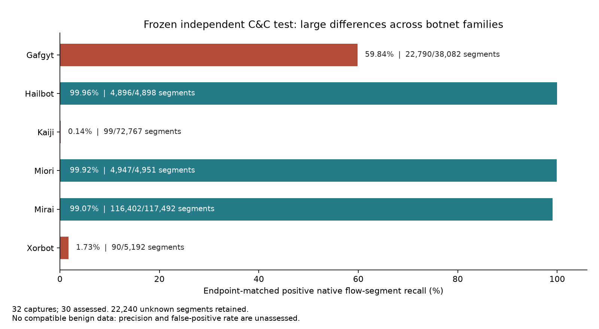

# Independent C&C test: 61.31% eligible-flow recall, severe family failures

Measured 23 November 2026. The frozen diagnostic detects **149,224 of 243,382 endpoint-matched
C&C flow segments (61.31%)** from CESNET-CC25. Kaiji recall is **0.14%**, Xorbot **1.73%**,
and two Gafgyt captures have zero detections. Mirai performs much better at **99.07%**.
The model remains rejected. This positive-only test cannot estimate precision or false-positive
rate, and it does not establish production readiness.

## What was frozen before access

[NAD-054 protocol](../docs/research/CESNET_FROZEN_TEST.md) and source role were committed at
`71178dc` before archive acquisition. The source was independent of the IoT-23 development
acquisition, although device/infrastructure/malware independence is unverified. The
[publisher record](https://zenodo.org/records/16752462) describes botnet C&C captures and
separate benign IPFIX data. We did not download that incompatible 14.9 GB benign archive.
CICIDS2017 remains reserved and unacquired.

Only the existing NAD-053 statistics27 control was scored, using the committed model SHA
`a504167cf9dbd384c17b192d2f1209714c8f4ef5c27e6b892b64fcbe04e19cc7` and threshold
`.9999190519374116`. Model bytes were checked before loading. No fitting, model selection,
threshold adjustment or endpoint-based prediction override occurred. Windows scored batches
of at most 1,024 rows at one thread. Public endpoint metadata determines label eligibility
outside the feature matrix; unmatched rows stay unknown, not benign.

## Complete acquisition and coverage

The 43,421,271-byte archive matches publisher MD5 `f66a6410bc1e35881f2de2077788847f`;
its SHA256 is `0df3c3f506ca49b5e3e0c74baa10251c02fa00ab2dd74ca428cb3d49a789f0da`.
All 260 archive members were inventoried within bounds. AppleDouble metadata and overlapping
hyphenated/underscored training/test copies were excluded. Exactly one unsplit released
capture per sample was selected: **32 captures / 92,367,380 bytes**, including publisher-filtered
files. This is complete coverage of that frozen released inventory, not an unfiltered network.

[Linux run 45237321471](https://github.com/LahsenAitOiahmane/NetAttDetector/actions/runs/45237321471)
at `5c313b3` passed the 235-value fixture and measured every selected capture. The separately
committed [measurement manifest](evidence/cesnet-frozen-test/manifest.json) at `cb1c1b7` pins
265,622 numeric rows and their byte/logical digests before private recovery/scoring.

| Coverage | Count |
|---|---:|
| Released captures measured | 32 |
| Captures with endpoint-matched eligible positives | 30 |
| Exported native flow segments | 265,622 |
| Endpoint-matched eligible positive segments | 243,382 |
| Unknown segments retained | 22,240 |
| Packet records in released unsplit files | 972,529 |
| Packets represented in eligible segments | 895,501 |
| Warm-up segments retained | 446 |
| Late flow starts observed | 0 |
| Maximum observed active/pending context events | 161 |

Captures `12-u7_4` and `27-u12_7` have 127 and 96 exported segments respectively, but **zero
matches to the published endpoint**. Their recall is null. Several annotated endpoints have
partial coverage. No endpoint was corrected after seeing data or predictions. Thus the headline
recall is conditional on the eligible subset; unsupported label coverage remains unresolved.

A post-score, model-independent [PCAPNG block audit](evidence/cesnet-frozen-test/packet-coverage.json)
reads the exact frozen file bytes and validates section byte order, block lengths, interfaces
and enhanced-packet lengths. **All 972,529 released packet records reconcile with exported
packet counters in every capture.** This does not validate checksums, payloads or label truth.
It does distinguish released-file completeness from publisher table consistency: the table
totals 1,112,743 C&C packets, with differences in samples 23, 25 and 27. In particular the
released Xorbot capture contains 15,952 packets versus 156,215 in the table. We retain this
discrepancy and make no inference about missing traffic. The scoring result is unchanged.

## Family and capture results

| Malware family | Assessed / released captures | Detected / eligible segments | Pooled positive recall |
|---|---:|---:|---:|
| Gafgyt | 10 / 10 | 22,790 / 38,082 | 59.84% |
| Hailbot | 4 / 5 | 4,896 / 4,898 | 99.96% |
| Kaiji | 1 / 1 | 99 / 72,767 | 0.14% |
| Miori | 1 / 1 | 4,947 / 4,951 | 99.92% |
| Mirai | 13 / 14 | 116,402 / 117,492 | 99.07% |
| Xorbot | 1 / 1 | 90 / 5,192 | 1.73% |

The unweighted mean of 30 assessed capture recalls is **84.86%**. Its registered 10,000-resample
capture bootstrap interval is **72.30–95.54%**, conditional on the observed captures. Pooled
recall is lower because poor Kaiji performance affects many segments. Neither statistic should
replace the other. Captures can share devices, C&C infrastructure and malware lineage, so the
interval does not provide independent-attack or population uncertainty. For one-capture
families, resampling yields a degenerate equal-endpoint interval; it supplies no meaningful
between-capture uncertainty. All individual results remain in
[evaluation.json](evidence/cesnet-frozen-test/evaluation.json).

These observations are NFStream segments under a two-second idle timeout. They are not Zeek
UID connections and must not be equated with the publisher's IPFIX flow counts. There is no
compatible benign packet set: precision, FPR, accuracy, balanced accuracy and ranking metrics
are deliberately unassessed. High recall in some families cannot remedy the prior development
FPR failure or the missed families here.

## Resources, private handling and reproducibility

The sum of per-capture export/SQLite intervals is **47.96 seconds**, with maximum sampled
process-tree RSS **157.0 MiB**. This excludes download, extraction, imports, fixture checks,
final verification and encryption. Local bounded scoring took **7.74 seconds / 162.6 MiB**,
excluding imports, model/data verification, model load and bootstrap. These are sampled
observations, not hard memory limits or live throughput evidence.

Kali WSL installed the locked environment but then failed to launch commands with filesystem
I/O errors before local fixture or measurement execution. No system repair or restart was
performed. GitHub Linux prepared the measurements; only recipient-encrypted numeric SQLite
and aggregate manifests were uploaded. The owner-held private key stayed on Windows.
Recovery verified the separately committed SQLite hash before opening the database, and
the committed model hash before joblib loading. Plaintext rows/model/key stay ignored locally.

The measurement suite passed 57 checks, and Python 3.11/3.13 CI each passed 231 with seven
platform/optional skips for the scoring implementation. The independent block parser has
additional known-endianness, count, truncation, malformed-interface and bounds tests.
Use the [reproduction runbook](../docs/guides/CESNET_FROZEN_TEST.md). The source is now observed
evaluation and cannot be presented as a fresh holdout for future tuning.

Next: improve diverse benign and missing-family development coverage with explicit source roles
and a new held-out evaluation plan, then revisit models. The real-network pilot remains deferred.

## Attribution

D. Oškera, J. Koumar, A. Pokorná, K. Jeřábek and T. Čejka, *Botnet Detection Through Periodic
Patterns in Command-and-Control Network Traffic*, CNSM 2025;
[CESNET-CC25 raw record, DOI 10.5281/zenodo.16752462](https://doi.org/10.5281/zenodo.16752462),
CC-BY-4.0. PCAPNG accounting follows the field layout in the
[IETF PCAPNG draft](https://www.ietf.org/archive/id/draft-ietf-opsawg-pcapng-06.html), with the
explicitly limited parser scope described above. MIT covers this project's code separately.
