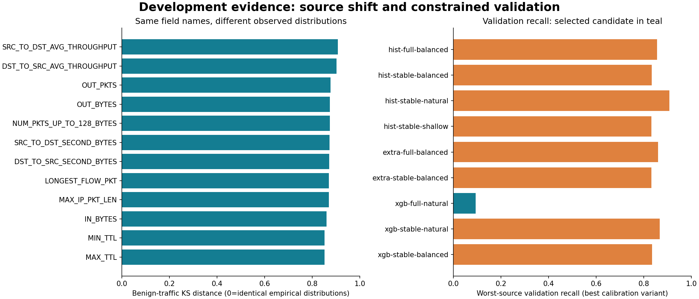
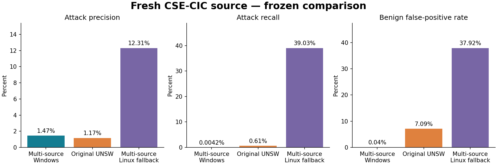

# Multi-source experiment and model card

**Release assessment: the selected candidate failed the independent-source quality gate. Do not deploy it for live protection.**

Registered protocol: version 2, amended from the development audit before any candidate fit or fresh holdout access.

## Data audit

| Source | Full rows scanned | Benign | Attack | Label/name disagreements |
|---|---:|---:|---:|---:|
| unsw | 2,390,275 | 2,295,222 | 95,053 | 0 |
| ton | 16,940,496 | 6,099,469 | 10,841,027 | 0 |

Full-feature repeated rows: **5,310,377**. Full-feature conflicting groups: **2,542**, containing **7,429** rows. These checks cover both complete development inputs.

The reduced representation has 10,090,679 rows in ambiguous groups. They are retained because dropping measurements can make distinct benign/attack observations indistinguishable; this is not automatically a label error. Reduced-feature groups stay together across development partitions.

The bounded cohort contains 195,894 rows after removing 55 sampled rows in globally conflicting full groups and 4,051 sampled full duplicates. Sampling then deduplicating changes prevalence; full counts and cohort counts are recorded in the audit JSON.

Feature dictionaries have matching hashes where reported; this confirms identical supplied definitions, not independently measured exporter parity. KS and source-conditional label associations describe shift without proving causation. All numeric nonfinite/coercion/range counts are in the audit. Fingerprints use 64-bit hashes of float32 representations, with a small theoretical collision risk.

## Development selection

### Original-model dependence diagnosis

On a capped development diagnostic sample, shuffling MIN_TTL changed the original model's average precision as follows. Positive drops indicate measured dependence; negative drops indicate the shuffle improved ranking. This sample may overlap original baseline fitting and is not independent performance evidence.

| Source | Mean AP drop when MIN_TTL is shuffled | Repeats |
|---|---:|---:|
| ton | -0.01992 | 3 |
| unsw | 0.69627 | 3 |

This supports a source-specific shortcut explanation alongside measured shift, but correlated predictors and unverified exporter semantics prevent a complete causal explanation. The primary [dataset paper, section 4](https://arxiv.org/html/2101.11315v2#S4) also excluded TTL from its UNSW experiments because of label association. Our frozen selected full-feature model still includes TTL and retains this limitation. Removing the six-field set did not meet the registered constraints in development. A targeted TTL-only ablation is a future experiment, not an unreported post-test model change.

The development cohort has 116 reduced-feature groups containing both labels. Any deterministic classifier restricted to that representation must make at least 2,770 errors on these recorded rows. This finite-cohort counting bound does not predict future-network performance.

Selected: **xgb-full-natural:none**, threshold `0.9936622381210327`. Constraints met in each development source: **True**.

| Candidate / calibration | Each-source constraints | Worst-source precision | Worst-source recall | Mean Brier | Fit seconds | Model bytes |
|---|---|---:|---:|---:|---:|---:|
| hist-full-balanced:none | False | 84.46% | 85.64% | 0.03760 | 21.13 | 213,500 |
| hist-full-balanced:sigmoid | False | 84.46% | 85.64% | 0.03584 | 21.13 | 214,327 |
| hist-stable-balanced:none | False | 82.65% | 83.36% | 0.05156 | 17.28 | 148,801 |
| hist-stable-balanced:sigmoid | False | 82.65% | 83.36% | 0.04542 | 17.28 | 149,596 |
| hist-stable-natural:none | False | 84.56% | 90.72% | 0.03520 | 19.14 | 204,685 |
| hist-stable-natural:sigmoid | False | 84.56% | 90.72% | 0.03172 | 19.14 | 205,460 |
| hist-stable-shallow:none | False | 82.42% | 83.18% | 0.04901 | 21.49 | 105,850 |
| hist-stable-shallow:sigmoid | False | 82.42% | 83.18% | 0.04593 | 21.49 | 106,643 |
| extra-full-balanced:none | False | 82.81% | 85.94% | 0.04100 | 6.66 | 1,833,886 |
| extra-full-balanced:sigmoid | False | 82.81% | 85.94% | 0.04310 | 6.66 | 1,834,745 |
| extra-stable-balanced:none | False | 74.82% | 83.16% | 0.09756 | 4.91 | 1,421,490 |
| extra-stable-balanced:sigmoid | False | 74.82% | 83.16% | 0.09544 | 4.91 | 1,422,284 |
| xgb-full-natural:none | True | 99.96% | 9.40% | 0.03442 | 4.62 | 159,749 |
| xgb-full-natural:sigmoid | True | 99.96% | 9.40% | 0.03455 | 4.62 | 160,626 |
| xgb-stable-natural:none | False | 84.86% | 86.67% | 0.05072 | 4.28 | 155,555 |
| xgb-stable-natural:sigmoid | False | 84.86% | 86.67% | 0.06152 | 4.28 | 156,396 |
| xgb-stable-balanced:none | False | 82.06% | 83.53% | 0.06375 | 4.75 | 80,622 |
| xgb-stable-balanced:sigmoid | False | 82.06% | 83.53% | 0.07080 | 4.75 | 81,460 |

These are model-selection results, not independent transfer estimates. Sigmoid calibration uses a disjoint calibration partition and never refits preprocessing/the classifier. Equal-source and equal-source/class weights affect training only.

Twenty source/label-stratified group folds approximate 60/15/25 train/calibration/validation, with disjoint reduced-feature groups. They are not time-, host- or session-held-out partitions. Exact row counts and source/class composition are recorded in the freeze.

### Illustrative validation trade-offs

These thresholds were explored on validation after freezing, without changing the selected artifact or testing alternatives on CSE. They illustrate constraint costs and are not new independent test results.

| Illustrative precision target | Feasible | Worst-source precision | Worst-source recall | Maximum source FPR |
|---|---|---:|---:|---:|
| 80.00% | True | 96.39% | 18.80% | 0.26% |
| 90.00% | True | 96.39% | 18.80% | 0.26% |
| 95.00% | True | 96.39% | 18.80% | 0.26% |
| 98.00% | True | 99.96% | 9.40% | 0.11% |

Other support/FPR confidence constraints remain enforced. The illustrative precision lower bound is min(0.95, target−0.03). Operational trade-offs require an agreed local alert budget.

## Frozen independent CSE-CIC result

Scanned 18,893,708 fresh-source rows. Evaluated 198,014 sampled, deduplicated rows, excluding 151 full-feature matches found anywhere in development. Reduced-representation overlaps and ambiguity are reported and retained.

| Frozen model | Accuracy | Attack precision | Attack recall | Benign FPR | Average precision |
|---|---:|---:|---:|---:|---:|
| multisource | 87.97% | 1.47% | 0.0042% | 0.04% | 0.20351 |
| original_unsw_baseline | 81.83% | 1.17% | 0.61% | 7.09% | 0.09755 |

The all-benign accuracy baseline is 88.00%. The selected model's 87.97% accuracy does not establish attack detection; its confusion matrix is {'tn': 174183, 'fp': 67, 'fn': 23763, 'tp': 1}.

Point precision/FPR targets met: **False**. This does not establish an acceptable production recall or alert/day budget. No parameter or threshold was changed after observing this result.

### Cross-environment reproduction did not match

The input checksums, global hash indexes and partition membership matched on Windows and Linux, but fitted XGBoost scores and the threshold differed. The Linux run found no feasible candidate and used the declared validation F1 fallback. The underlying cause is not established; numerical, stochastic or row-order differences require further investigation. Fixed seeds do not establish identical training across platforms.

Linux fallback on the identical 198,014 CSE rows: precision **12.31%**, recall **39.03%**, FPR **37.92%**, threshold `0.7089409828186035`. This variant also fails the quality gate and is not a replacement chosen after seeing CSE. Both frozen results are retained.

| New-model metric | Conditional Wilson 95% interval |
|---|---|
| attack_precision | 0.26%–7.87% |
| attack_recall | 0.0007%–0.02% |
| false_positive_rate | 0.03%–0.05% |

These intervals assume independent labeled rows and exclude capture dependence, label uncertainty and model-selection uncertainty.

| Attack family | Attack rows | Recall | Conditional 95% interval |
|---|---:|---:|---|
| Bot | 1,441 | 0.00% | 0.00%–0.27% |
| Brute Force -Web | 21 | 0.00% | 0.00%–15.46% |
| Brute Force -XSS | 12 | 0.00% | 0.00%–24.25% |
| DDOS attack-HOIC | 11,429 | 0.00% | 0.00%–0.03% |
| DDOS attack-LOIC-UDP | 19 | 0.00% | 0.00%–16.82% |
| DDoS attacks-LOIC-HTTP | 3,163 | 0.00% | 0.00%–0.12% |
| DoS attacks-GoldenEye | 304 | 0.00% | 0.00%–1.25% |
| DoS attacks-Hulk | 4,580 | 0.02% | 0.0039%–0.12% |
| DoS attacks-SlowHTTPTest | 147 | 0.00% | 0.00%–2.55% |
| DoS attacks-Slowloris | 115 | 0.00% | 0.00%–3.23% |
| FTP-BruteForce | 266 | 0.00% | 0.00%–1.42% |
| Infilteration | 1,259 | 0.00% | 0.00%–0.30% |
| SQL Injection | 5 | 0.00% | 0.00%–43.45% |
| SSH-Bruteforce | 1,003 | 0.00% | 0.00%–0.38% |

## Resource scope and deployment status

Selection/training: 167.47 seconds, sampled peak process RSS 388.5 MiB, two configured threads. Selected bundle: 160,504 bytes. Warm inference median/p95: 9.76/11.90 ms per 2048 rows. Parsing, export and queueing are excluded. Audit preparation and holdout scanning are separate measurements.

This is a research artifact. Live exporter parity, host/time robustness, minority support, local shadow testing, operational alert budgets and commercial-use permissions remain unresolved release gates.

## Verified evidence and review

The registered classifier search and both initial freezes used source commit `07e25ff`.
[The Linux experiment](https://github.com/LahsenAitOiahmane/NetAttDetector/actions/runs/40972007019)
completed successfully as execution while failing model-quality constraints. The local freeze
was also complete before fresh-source scoring; no CSE-based retuning occurred. CSE is now an
observed test source and cannot be reused as an untouched development holdout.

Evidence: [global audit](evidence/multisource/audit.json),
[feature diagnostics](evidence/multisource/feature-diagnostics.json),
[baseline dependence diagnostics](evidence/multisource/baseline-diagnostic.json),
[local freeze](evidence/multisource/local-freeze.json),
[local holdout](evidence/multisource/local-holdout.json),
[cloud freeze](evidence/multisource/cloud-freeze.json),
[cloud holdout](evidence/multisource/cloud-holdout.json), and
[CSE acquisition manifest](evidence/multisource/cse-download.manifest.json).

The [export-only job](https://github.com/LahsenAitOiahmane/NetAttDetector/actions/runs/40974339706)
converted the already fitted cloud model through stable UBJSON without refitting or changing its
threshold. It then loaded on Windows and matched all 5,000 threshold decisions, with maximum
probability difference 7.45e-9. A 1,000-real-flow inference check also completed. This fixes
cross-platform loading of that artifact; it does not resolve training variability.
See [conversion provenance](evidence/multisource/cloud-portable-conversion.json) and
[Windows parity verification](evidence/multisource/windows-portable-verification.json).

Validation: 35 local tests passed, with lint/format checks passing. [GitHub CI](https://github.com/LahsenAitOiahmane/NetAttDetector/actions/runs/40975439884)
passed on Python 3.11/3.13 with 33 core tests and two optional-XGBoost tests skipped in the core
environment; the export job separately exercised XGBoost portability on Linux, and the full
optional suite passed locally. Both figures were visually inspected.

Review: [draft PR #3](https://github.com/LahsenAitOiahmane/NetAttDetector/pull/3).
The next research priority is targeted measurement/TTL validation, individual feature-family
ablations, repeated-seed/threshold stability, and capture-aware/local data. The six-field ablation
and simply combining more rows did not establish useful independent-source detection.
