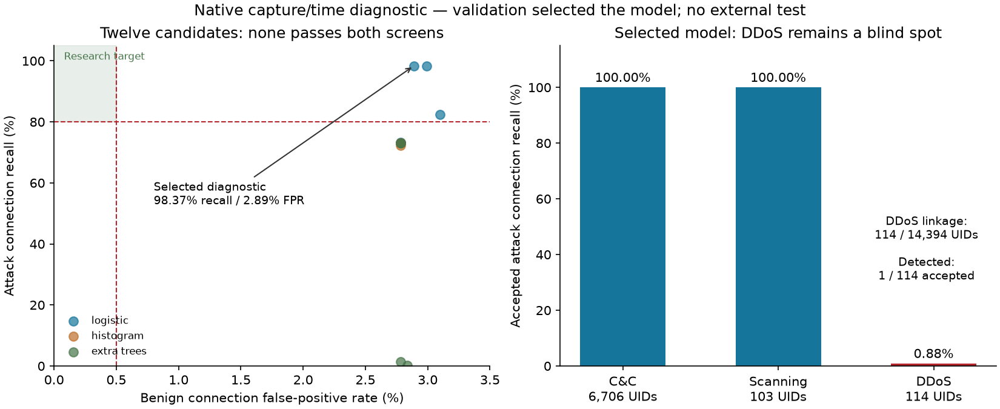

# Native capture/time baseline: strong aggregate scores, failed acceptance

Measured 1 November 2026. **None of twelve native-feature candidates qualifies.** The selected
diagnostic reaches 99.20% precision and 98.37% recall on accepted validation connections, but
its **2.89% benign FPR exceeds the 0.5% research screen**, and it detects only **1 of 114**
accepted DDoS connections. No production/public-model promotion follows from these scores.

## Registered experiment and actual outcome

Registered [the protocol](../docs/research/NATIVE_STUDY.md) and
[configuration](../configs/native-study.json) at `ae8c23c` before inspecting native scores.
Preparation remains training-disabled; this separate protocol explicitly authorizes only an
experimental diagnostic fit on the immutable accepted-label subset, with capture/time-only
scope and unverified device independence. Candidate labels are not promoted.

[Run 41310297418](https://github.com/LahsenAitOiahmane/NetAttDetector/actions/runs/41310297418)
at `907868a` completed all **15 fits**: one dummy, twelve predefined candidates and two repeat/
thread controls. It exited with an error because the one-thread control exceeded its registered
score tolerance, not because fits were missing. Aggregate evidence and the diagnostic freeze
were retained; the quality CI and exporter fixtures passed separately.

The cohort's logical digest remains `9be2a2d5c39b3cb78a31fec40118971ba03b0e62b398e1151f7480ce8c312d59`.
Training/capture 3 has 222,681 accepted rows, calibration/capture 8 has 12,459, and validation/
capture 34 has 13,857. All 1,822 excluded flows remain in the private cohort and outside fitting.
No label repair, conflicting-row deletion, external-test access or threshold retuning occurred.

## Comparison at calibration-only thresholds

Metrics below use the maximum segment score within each accepted capture-scoped UID. They
describe connections, not independent incidents, devices or reviewed alerts. Validation chose
the diagnostic specification; it is development data rather than an untouched final test.

| Model / features / training weights | Validation precision | Recall | Benign FPR |
|---|---:|---:|---:|
| Dummy prior | 78.43% | 100% | 100% |
| Logistic / native 11 / natural | 99.17% | 98.37% | 2.99% |
| **Logistic / native 11 / connection-class balanced** | **99.20%** | **98.37%** | **2.89%** |
| Logistic / behavioral + derived / natural | 98.98% | 82.33% | 3.10% |
| Logistic / behavioral + derived / balanced | 98.97% | 73.23% | 2.78% |
| Histogram / native 11 / natural | 98.96% | 73.13% | 2.78% |
| Histogram / native 11 / balanced | 98.95% | 72.34% | 2.78% |
| Histogram / behavioral + derived / natural | 98.96% | 73.13% | 2.78% |
| Histogram / behavioral + derived / balanced | 98.96% | 73.13% | 2.78% |
| Extra Trees / native 11 / natural | 65.58% | 1.46% | 2.78% |
| Extra Trees / native 11 / balanced | 15.63% | 0.14% | 2.84% |
| Extra Trees / behavioral + derived / natural | 98.96% | 73.13% | 2.78% |
| Extra Trees / behavioral + derived / balanced | 98.96% | 73.13% | 2.78% |

All twelve candidates found a calibration precision/FPR/support-feasible threshold. All failed
the combined calibration/validation research screen. A larger tree ensemble did not improve
transfer. Model selection retained the highest validation-F1 diagnostic, not a deployable model.

## Selected diagnostic details and limitations

Selected `logistic-native11-connection_class_balanced`, threshold **0.9921028048109991**. The
threshold was selected on calibration UIDs only, where it flags 8,222/8,222 attack connections
and 2/2,181 benign connections. Validation confusion matrix: **TN 1,849 / FP 55 / FN 113 /
TP 6,810**. Conditional Wilson 95% intervals are precision 98.96–99.38%, recall 98.04–98.64%,
FPR 2.23–3.74%; they do not cover dependence, capture-level variability or model selection.

Accepted-family recall on validation: C&C **6,706/6,706**, scanning **103/103**, DDoS **1/114**.
The total dataset has 14,394 publisher DDoS UIDs, with only 114 accepted by linkage; report that
coverage gap beside model recall. The trained capture contains no accepted DDoS UID and only
eight C&C UIDs, despite many timeout segments. This is not broad attack-family evidence.

Natural validation **flow** precision/recall/FPR are 99.48% / 98.78% / 2.92%. Calibration flow
recall is 80.00% while connection recall is 100%, illustrating how UID-max aggregation changes
the question. Neither figure measures alert usefulness within the user's 50 reviewed alerts/day.

## Feature information and reproducibility

The eleven-feature policy has 128,407 exact patterns; sixteen conflicting-label patterns affect
50 accepted rows. Removing ports and adding ratios/smoothed rates leaves only **11,427 patterns**;
58 conflicting-label patterns now cover **206,404 rows**. The derived transforms cannot recover
information absent from those inputs. All conflicts/repetitions remain present; their removal
would make this benchmark less representative of its observed ambiguity.

Every saved/reloaded artifact reproduced its probe scores and decisions exactly. The selected
two-thread refit also matched validation scores exactly. Changing **training** to one thread
produced maximum score difference **1.41355e-6**, above the preregistered **1e-7** limit, with
zero validation decision differences at the frozen threshold and a changed calibration
threshold. This failure is retained. It does not resolve the older UQ/XGBoost discrepancy, and
the tolerance is not relaxed to turn the run green. Prediction already used one thread.

## Resources, licensing and next work

All fits, scoring, serialization, overlap diagnostics and controls took **36.99 seconds** and
sampled **469.2 MiB** process-tree RSS. This excludes imports, acquisition, cohort construction
and initial verification; sampling is not a hard memory/time guarantee. The selected compressed
bundle was 1,781 bytes, fitted in .96 seconds, and its single warmed 5,000-row prediction probe
took .81 ms. The probe excludes I/O, exporting, sensing and alert management; it is not a live
throughput claim. Actual training used CPU only and at most two threads.

Only [aggregate study evidence](evidence/native-study/study.json),
[configuration](evidence/native-study/study-config.json) and
[freeze](evidence/native-study/freeze.json) are committed. Private models/rows expired with the
runner; reproduction creates them again on private Linux storage. The owner selected MIT for
project code and deferred the real-network pilot. Dataset/public-model terms remain separate.
Source/wheel builds passed and the wheel includes `License-Expression: MIT` and the LICENSE.

Next: fixed-thread logistic repeat diagnostics, aggregate false-positive/family error analysis,
and a measured richer feature contract before another bounded fit. Packet length/timing and
TCP-state counters are candidates to validate, not assumed improvements. More representative
benign and attack captures may be needed; retain a compatible independent source for a later
frozen evaluation. Do not deploy this diagnostic, expand service/dashboard scope to conceal
the quality failure, or repeatedly tune the reserved test.
