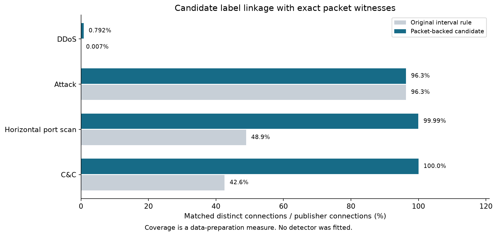

# Exact packet witnesses and native-data readiness

Measured 31 October 2026. **The packet-backed candidate links 248,997 of 250,819 native flows,
up from 161,949, while preserving every previously accepted match.** This is label-linkage
coverage, not detector accuracy. No model was fitted and the candidate is not promoted.

## Integration and registered experiment

PR #7 was merged into `codex/labelled-development-captures` at `0aeaf35`, while main contained
PR #6 at `bb410b8`. This sprint starts from that merged state; the next PR targets **main** and
includes the earlier expansion so the work is integrated into the primary branch.

Registered the [packet-witness protocol](../docs/research/PACKET_LABELS.md) and
[policy](../configs/data/packet-evidence.json) at `9df84d7` before independent packet inspection.
Only pinned IoT-23 development captures 8/34/3 are used. No additional datasets were needed;
CICIDS2017 remains reserved/unacquired and CSE remains observed evaluation.

The [measured run 41242568757](https://github.com/LahsenAitOiahmane/NetAttDetector/actions/runs/41242568757)
at `653e8d6` passed the original measurement fixtures, every saved v1 replay/digest check,
previous-match preservation and the resource screens. The later adjacent-partition implementation
uses `pairwise` to satisfy lint; it does not change the experiment's matching logic/results.
The earlier run `41241945740` produced the same baseline/candidate counts.
See [full aggregate evidence](evidence/packet-labels/cloud/summary.json).

## What an exact witness establishes

The independent classic-PCAP reader decodes Ethernet/VLAN, IPv4/IPv6 base headers and TCP/UDP
structure with integer nanosecond timestamps. It counts unsupported/truncated records explicitly.
Packet indexes contain only tuple/time/header metadata and counters, never payload bytes.
Structural decoding is not checksum validation, reassembly, payload analysis or proof of an attack.

The candidate requires an explicit one-packet claim, exact timestamp/tuple agreement with one
decoded packet, matching direction and IP bytes, and no packet shared by eligible UID claims.
Known-duration single-packet claims also participate in collision checks. Only then can a
missing connection end become its witnessed instant. A new point-linked NFStream flow must
itself contain one packet, have zero duration and agree on direction, timestamp and byte count.

Unproven ends remain blockers. Known intervals retain their boundaries; packet tails are not
silently added. Resolving proven ends can also unblock an existing known interval that previously
overlapped an assumed unknown-length connection. This explains why coverage gains include more
than newly witnessed point records. Neither operation invents labels for unmatched traffic.

## Results on the same native flow streams

| Capture | Exported flows | Original / candidate matched flows | Additional matches | Candidate benign / attack UIDs | Audit seconds | Sampled tree RSS sum MiB |
|---|---:|---:|---:|---:|---:|---:|
| 8-1 | 12,459 | 5,662 / 12,459 | 6,797 | 2,181 / 8,222 | 3.32 | 167.6 |
| 34-1 | 13,972 | 9,549 / 13,857 | 4,308 | 1,904 / 6,923 | 9.76 | 183.4 |
| 3-1 | 224,388 | 146,738 / 222,681 | 75,943 | 3,169 / 151,346 | 65.63 | 329.7 |
| Total | 250,819 | 161,949 / 248,997 | 87,048 | 7,254 / 166,491 | 78.71 | — |

The candidate covers 99.27% of exported flows in these three captures. Distinct UIDs remain
capture-scoped; they are not proof of independent attacks or devices. The rule never converted
an unlabelled record into benign by default. No previously accepted UID/class/detail changed
or disappeared. Archived v1 aggregates and ordered assignment digests matched exactly.

| Publisher detail | Publisher UIDs | Original matched UIDs | Candidate matched UIDs | Candidate coverage |
|---|---:|---:|---:|---:|
| C&C | 14,936 | 6,358 | 14,936 | 100% |
| Horizontal port scan | 145,719 | 71,317 | 145,699 | 99.99% |
| Attack | 5,962 | 5,742 | 5,742 | 96.31% |
| DDoS | 14,394 | 1 | 114 | 0.792% |

Remaining candidate exclusions across captures: 1,325 unsupported-protocol flows, 333 partial
intervals, 69 ambiguous flows, 93 unknown-label/duration flows and two unmatched flows.
Training/evaluation must preserve this coverage accounting rather than silently dropping it
from a claimed whole-network detection metric. Matched data is still heavily attack-skewed.

## DDoS contradiction and packet-level limitations

The 34-1 log has 14,381 DDoS records with missing duration. Of these, 121 declare one packet
and have valid exact witnesses. The remaining **14,260 declare zero packets**, even though
each has exactly one structurally decoded packet at its exact timestamp and tuple. All those
packet witnesses have combined TCP flags `0x3a` and a nonzero header-derived payload length.
This records header facts; the payload content was not inspected.

The experiment does not guess why the publisher counters are zero, change them to one or
promote those records into point labels. Their connection-label semantics require separate
review. Thus the large DDoS gap remains despite substantial improvements elsewhere. A broad
attack-detection claim would still be unsupported.

The 34-1 PCAP also contains 57,489 IPv4 fragments, which this reader deliberately does not
reassemble. Other captures include non-IP Ethernet and unsupported transport records. The
flow-level model contract alone does not describe every captured packet. Fragment handling,
protocol/state observability, checksum behavior, packet tails and loss remain explicit work.

The largest temporary packet database was 98,136,064 bytes. Processing uses an 8 MiB SQLite
cache target, a 512 MiB main-file cap, PCAP cap of 128 MiB and two-million-record limit.
All three captures met the registered <1 GiB/<600-second offline resource screens. RSS sums
are sampled every 50 ms, can miss brief peaks and double-count shared pages; these are not
OS-enforced guarantees or live throughput/loss measurements. Downloads are excluded.

Windows independently reproduced the cloud packet counts and point evidence on all three
captures without a capture driver or NFStream export. Its largest label/packet inspection
used 55.2 MiB sampled process memory; see the [local evidence](evidence/packet-labels/local/CTU-IoT-Malware-Capture-3-1-packet-evidence.json).

## Proposed native partitions and remaining gates

The [native dataset plan](../configs/data/native-dataset-plan.json) now identifies concrete
capture/time partitions rather than inventing missing timestamps in the old UQ CSVs:

| Proposed partition | Capture | Verified UTC event range | Candidate benign / attack UIDs |
|---|---|---|---:|
| Train | 3-1 | 19–21 May 2018 | 3,169 / 151,346 |
| Calibration | 8-1 | 31 July–1 August 2018 | 2,181 / 8,222 |
| Validation | 34-1 | 21–22 December 2018 | 1,904 / 6,923 |

Chronological ordering, the 300-second inter-capture purge and the 25-connections/class screen
pass. Future row groups must use source + capture + UID and keep every segment of a connection
together. Persistent device identity is unverified, so this is **not a host-disjoint benchmark**.
No row-level native training cohort is materialized yet; the candidate label rule and training
remain disabled for promotion. The original blocked global capture plan is retained.

Next work: review the point-label evidence and DDoS counter contradiction; materialize the
native feature/UID cohort with full inclusion/exclusion and overlap audits; resolve device/split
provenance; then preregister a bounded baseline/calibration experiment. Keep the independent
source untouched until the model and operating point are frozen. Dataset terms and the local
flow-volume/alert-aggregation budget remain release/pilot gates.

## Validation and reproduction

The full local suite passed 111 tests and skipped two Linux-only cases. After adding the
known-interval tail regression, all 22 packet tests passed. Tests cover PCAP endianness/time
precision, independently known IP byte counts, IPv6, VLANs, structural errors, fragments,
truncation, exact timing, packet/directional byte mismatches, claim collisions, unknown classes,
one-packet flow checks and preservation of known intervals. Linux CI runs the real exporter.

Windows can run `netatt audit-packet-labels --capture-dir ... --output fresh.json` without a
capture driver; Linux can append `--compare-flows`. The
[operations guide](../docs/guides/PACKET_LABELS.md) provides complete commands and limits.
Only aggregate evidence/configurations/receipts are published; raw PCAPs, endpoint/UID rows,
claims and temporary databases remain ignored. No live sensing, packet transmission, blocking,
model fitting or deployment was introduced.
