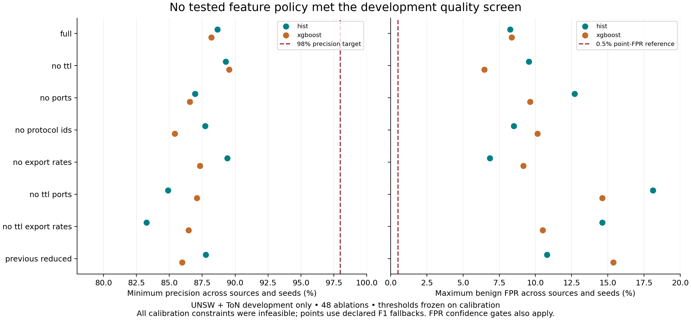
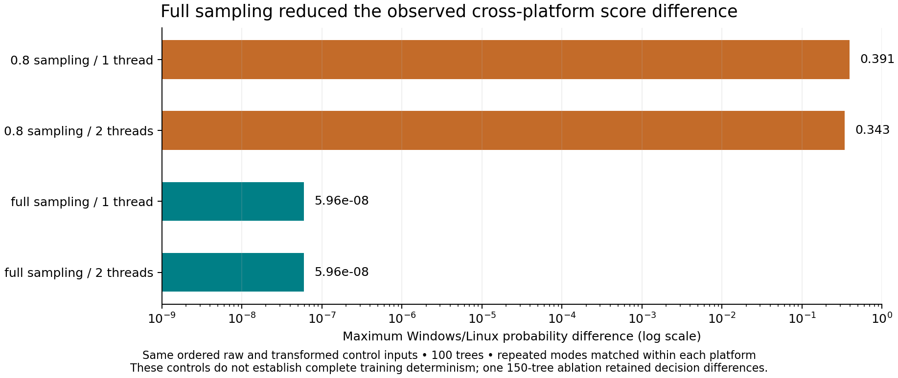

# Development ablation and training-stability report

This is development evidence from UNSW/ToN only. CSE was previously observed and failed; it was not read, tuned against or scored in this study. No new independent source was consumed. The 80% recall screen is a registered research target, not an agreed operational SLO.

Local source revision: `831363565319a8c5b313bf39c9b062afc03c2448`; dirty: `False`. Completed 48/48 ablations, 8/8 controls and 4/4 known-source transfer fits in 714.2 seconds; sampled peak process RSS 424.5 MiB. Start-new-fit deadline exhausted: `False`.

Thresholds were chosen on calibration observations and then frozen for validation. No probability-calibration layer was fitted. Source names are metadata; direct float32 weights give each source equal total contribution. Input order and matrices were canonicalized. Histogram boosting used 150 iterations with early stopping disabled; XGBoost used 150 trees with full row/column sampling. Model seed was 42; partition seeds were 7, 42 and 101.

## Isolation and measurement

The common 30-field grouping retained all 195,894 cohort rows in 29,361 groups. The largest group contained 20,302 rows; 48,138 rows belonged to groups with mixed labels. These observations were retained together, not removed to improve scores. Partitions therefore differ from the previous 34-field protocol. Hashes operate on float32 representations; theoretical collisions and near-duplicates remain limitations.

| Seed | Train | Calibration | Validation |
|---|---:|---:|---:|
| 42 | 120,708 | 28,171 | 47,015 |
| 7 | 120,890 | 28,104 | 46,900 |
| 101 | 120,927 | 28,089 | 46,878 |

0 ablations had exact post-preprocessing input overlap between partitions. Any such overlap fails the screen. This check does not establish capture/session independence.

Zero TTL/duration values and counter/rate distributions are recorded in `measurements.json`. No zero value was reinterpreted as missing, and no labels were repaired. Matching published field dictionaries do not prove matching exporters, timeouts, units or direction semantics.

| Source / binary label | Sample rows | Minimum TTL zero |
|---|---:|---:|
| nf-ton-iot-v2 / benign | 35,704 | 84.77% |
| nf-ton-iot-v2 / attack | 62,549 | 52.05% |
| nf-unsw-nb15-v2 / benign | 94,350 | 0.03% |
| nf-unsw-nb15-v2 / attack | 3,291 | 0.15% |

## Feature-policy results

Each value below is the worst source/partition seed except AP, which averages sources/seeds. The screen requires every source and seed to meet precision ≥98%, precision Wilson lower bound ≥95%, FPR Wilson upper bound ≤0.5%, ≥25 alerts and recall ≥80%, with a feasible calibration threshold and uncontaminated partitions. Conditional intervals assume independent labeled rows. Repeated development splits are dependent and do not give a generalization CI.

| Model / policy | Fields | Min precision | Min recall | Max FPR | Mean AP | All seeds pass |
|---|---:|---:|---:|---:|---:|---|
| hist / full | 40 | 88.66% | 86.24% | 8.24% | 0.9686 | False |
| hist / no_ttl | 38 | 89.28% | 80.99% | 9.55% | 0.9627 | False |
| hist / no_ports | 38 | 86.96% | 85.35% | 12.70% | 0.9668 | False |
| hist / no_protocol_ids | 38 | 87.72% | 86.27% | 8.51% | 0.9716 | False |
| hist / no_export_rates | 36 | 89.41% | 85.76% | 6.86% | 0.9708 | False |
| hist / no_ttl_ports | 36 | 84.90% | 93.15% | 18.13% | 0.9602 | False |
| hist / no_ttl_export_rates | 34 | 83.26% | 93.95% | 14.62% | 0.9577 | False |
| hist / previous_reduced | 34 | 87.78% | 81.60% | 10.79% | 0.9603 | False |
| xgboost / full | 40 | 88.20% | 85.32% | 8.36% | 0.9696 | False |
| xgboost / no_ttl | 38 | 89.54% | 85.13% | 6.46% | 0.9618 | False |
| xgboost / no_ports | 38 | 86.56% | 83.79% | 9.63% | 0.9632 | False |
| xgboost / no_protocol_ids | 38 | 85.41% | 85.83% | 10.14% | 0.9689 | False |
| xgboost / no_export_rates | 36 | 87.33% | 85.49% | 9.17% | 0.9669 | False |
| xgboost / no_ttl_ports | 36 | 87.10% | 80.00% | 14.63% | 0.9543 | False |
| xgboost / no_ttl_export_rates | 34 | 86.46% | 83.58% | 10.50% | 0.9585 | False |
| xgboost / previous_reduced | 34 | 85.98% | 85.42% | 15.39% | 0.9545 | False |

Calibration feasibility: 0/48. Infeasible cases use the declared worst-source F1 fallback. The reported high recalls are not recalls achieved at the requested precision/FPR constraints.

**0 of 16 model/policy combinations passed every seed.** No model is promoted by a development screen.

## Training controls

Each control uses the same seed-42 rows/labels/weights and 100 XGBoost trees. Only row/column sampling (0.8/0.8 versus 1/1) and one/two CPU threads change. Each mode repeats twice. Stable tree bytes are retained as hashes; validation score arrays are retained in workflow/local artifacts.

| Mode | Local repeat max probability difference |
|---|---:|
| stochastic-1t | 0 |
| stochastic-2t | 0 |
| full-1t | 0 |
| full-2t | 0 |

Linux source revision: `831363565319a8c5b313bf39c9b062afc03c2448`; dirty: `False`. Completed 48 ablations; 0 combinations passed every seed. Runtime 322.2 seconds, sampled peak process RSS 551.7 MiB.

Cross-platform ordered raw payloads/labels/weights matched: `True`. The comparison also requires identical post-preprocessing training and validation matrices and all eight controls. A score difference with these inputs fixed is a fitting/runtime difference; it does not establish a specific implementation cause or explain the old run.

| Control | Windows/Linux max probability difference | Exact scores |
|---|---:|---|
| full-1t:0 | 5.96046448e-08 | False |
| full-1t:1 | 5.96046448e-08 | False |
| full-2t:0 | 5.96046448e-08 | False |
| full-2t:1 | 5.96046448e-08 | False |
| stochastic-1t:0 | 0.390698135 | False |
| stochastic-1t:1 | 0.390698135 | False |
| stochastic-2t:0 | 0.342702746 | False |
| stochastic-2t:1 | 0.342702746 | False |

Stable tree bytes matched in 0/8 controls. Numeric score agreement and serialized-model identity are different checks. At the diagnostic threshold 0.5, full controls had at most 0 decision disagreements; sampled one/two-thread controls had 113/87. This threshold is only a reproducibility probe, not a selected detector.

| Platform | Sampled: 1 versus 2 threads | Full: 1 versus 2 threads |
|---|---:|---:|
| Windows | 0.343826979 | 0 |
| Linux | 0 | 0 |

All three ordered partition payloads matched: `True`. Of 48 matched ablations, 4 had any source-metric difference and 1 had different source confusion matrices. The remaining discrepancy prevents a claim of fully resolved training determinism. These controls changed ordering, weights, memory layout and sampling from the previous phase; they do not isolate the old discrepancy's cause.

Residual case: xgboost / no_protocol_ids, seed 7; thresholds 0.522100329 versus 0.523351192. Maximum source recall difference 0.1235 percentage points; FPR difference 0.2259 points. Both evaluations failed the registered quality screen.

## Known-source transfer diagnostics

Only the origin source's train/calibration rows fit the model and choose its threshold. The other source's validation observations are scored without fitting. Both sources were already used in research, so these are diagnostics, not independent test results.

| Policy | Training → validation source | Precision | Recall | FPR | Origin calibration feasible |
|---|---|---:|---:|---:|---|
| full | nf-ton-iot-v2 → nf-unsw-nb15-v2 | 37.65% | 7.90% | 0.41% | True |
| full | nf-unsw-nb15-v2 → nf-ton-iot-v2 | 53.37% | 1.17% | 4.99% | True |
| no_ttl | nf-ton-iot-v2 → nf-unsw-nb15-v2 | 29.83% | 12.96% | 0.96% | True |
| no_ttl | nf-unsw-nb15-v2 → nf-ton-iot-v2 | 17.06% | 0.25% | 6.03% | False |

## Decision and remaining work

Keep the research artifacts and the earlier failed external results. Use the measured policies to prioritize further research; do not choose a production subset from these development results alone. First recover capture/time/host metadata and verify actual flow-export measurements on controlled PCAP fixtures, then reserve a fresh source before fitting. Agree an operator alert budget before a passive shadow pilot. More trees or a larger random sample cannot by themselves establish measurement parity or new-source robustness.

See the preregistered [protocol](../docs/research/STABILITY_PROTOCOL.md), [reproduction guide](../docs/guides/STABILITY_OPERATIONS.md) and [ordered backlog](../docs/project/ROADMAP.md). Full per-source metrics, confidence intervals, attack-family slices, input signatures and resource measurements are in the saved JSON evidence.

## Evidence and validation

The registered protocol was committed as `b730df3`, then amended to the conservative
common-feature grouping and source-transfer diagnostics before fits in `8313635`.
Both platforms ran that clean source revision. The later comparison/report changes read
saved evidence and never refit a classifier. All earlier frozen models and CSE receipts
remain unchanged. No new detector was exported or promoted from this study.

[Local study](evidence/stability/local-study.json),
[Linux study](evidence/stability/cloud-study.json),
[measurement audit](evidence/stability/measurements.json), and
[verified numerical comparison](evidence/stability/comparison.json) retain the complete metrics,
source/config/cache digests, source/seed partitions, dependency versions and hardware scope.
The [GitHub study](https://github.com/LahsenAitOiahmane/NetAttDetector/actions/runs/40979423634)
passed its optional-dependency test suite and completed all registered fits. Downloaded score
arrays remain under `artifacts/github-40979423634/` and `artifacts/stability-local/` locally;
the remote artifact retention is 14 days. Raw development archive downloads were reused locally.
Wall time excludes cache loading/common-group construction, while the sampled process RSS
includes the loaded cohort; raw archive preparation is a separate step.

Validation: 42 local tests pass, including ambiguity-preserving grouping, source weights,
isolation, low-recall rejection, mismatch/incomplete-control refusal and score-array integrity.
Lint/format checks pass. Both figures were rendered and visually inspected. See
[draft PR #4](https://github.com/LahsenAitOiahmane/NetAttDetector/pull/4) for review. Phase 2
was already merged through PR #3; this study is a separate change on `codex/development-stability`.
The [source CI](https://github.com/LahsenAitOiahmane/NetAttDetector/actions/runs/40981337704)
passed on Python 3.11/3.13 with 39 core tests and three optional tests skipped per environment.
