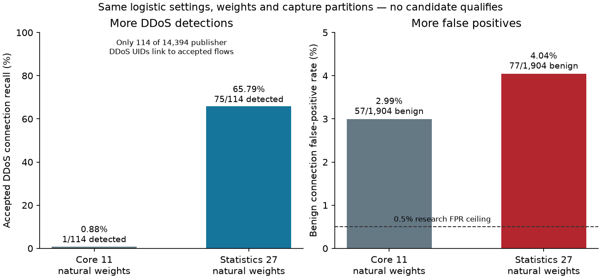

# Statistical models: DDoS improvement, false-positive failure retained

Measured 1 November 2026. **None of twelve candidates qualifies.** In the controlled natural-
weight logistic comparison, richer statistics increase accepted DDoS detection from **1/114
to 75/114**, but benign false positives increase from **57 to 77**. The selected statistical
diagnostic has 98.89% precision / 99.44% recall with **4.04% benign FPR**, above the unchanged
0.5% research screen. It remains unsuitable for deployment.

## Registered inputs and procedure

Registered [the protocol](../docs/research/STATISTICAL_STUDY.md) at `5ebc599` before statistical
fits. [Run 41315585426](https://github.com/LahsenAitOiahmane/NetAttDetector/actions/runs/41315585426)
at `0bc2f70` passed both pinned logical-digest checks, all fifteen fits, serialization/repeat
and resource screens. A green experiment workflow means a reproducible completed experiment,
not that a detector qualified. No reserved source or fresh external test was accessed.

The same 248,997 accepted-label rows use train capture 3, calibration capture 8 and validation
capture 34. All 1,822 exclusions stay in the private original cohort. Twelve candidates cover
logistic/histogram models, core11/statistics27/statistics25-no-port policies and natural versus
connection/class training weights. One dummy and two selected-model refits complete fifteen
fits. Every fit/prediction uses one thread. Parameters and calibration/validation rules stay
fixed; this is not a new hyperparameter search or a device-independent benchmark.

## Connection metrics at calibration-only thresholds

| Model / inputs / training weights | Validation precision | Recall | Benign FPR | Accepted DDoS recall |
|---|---:|---:|---:|---:|
| Logistic / core11 / natural | 99.17% | 98.37% | 2.99% | .88% |
| Logistic / core11 / balanced | 99.20% | 98.37% | 2.89% | .88% |
| **Logistic / statistics27 / natural** | **98.89%** | **99.44%** | **4.04%** | **65.79%** |
| Logistic / statistics27 / balanced | 99.16% | 94.28% | 2.89% | 37.72% |
| Logistic / no-port statistics25 / natural | 98.95% | 79.13% | 3.05% | .88% |
| Logistic / no-port statistics25 / balanced | 98.93% | 73.15% | 2.89% | .88% |
| Histogram / core11 / natural | 98.96% | 73.13% | 2.78% | 0% |
| Histogram / core11 / balanced | 98.95% | 72.34% | 2.78% | 0% |
| Histogram / statistics27 / natural | 98.96% | 73.13% | 2.78% | 0% |
| Histogram / statistics27 / balanced | 98.89% | 72.34% | 2.94% | 0% |
| Histogram / no-port statistics25 / natural | 98.96% | 73.13% | 2.78% | 0% |
| Histogram / no-port statistics25 / balanced | 99.00% | 79.84% | 2.94% | 0% |

The dummy flags every connection (100% FPR). Core controls reproduce the earlier point-metric
results, isolating the measured-field comparison under fixed one-thread training. All candidates
remain above the validation FPR screen; validation selected the diagnostic, so these are
development results rather than final-test evidence.

## Selected specification and failure slices

Selected `logistic-statistics27-flow_natural`, threshold **0.9999190519374125**. Calibration
connection precision/recall are 100% with zero observed false positives; that does not transfer
to validation. Validation confusion counts: **TN1,827 / FP77 / FN39 / TP6,884**. Conditional
Wilson 95% intervals are precision 98.62–99.11%, recall 99.23–99.59%, FPR 3.25–5.03%. They
assume independent UIDs and do not cover capture dependence, device independence or selection.

C&C/scanning accepted-family recall is 6,706/6,706 and 103/103; DDoS is 75/114. The label join
still covers only 114 of 14,394 publisher DDoS UIDs, so this does not establish broad DDoS
performance. Natural validation flow precision/recall/FPR are 99.23% / 99.67% / 4.35%.

All 77 false-positive UIDs are TCP. At their highest-scoring observed segment, the destination
bucket is HTTP/80 for 56, DNS/53 for 18 and other for three; these are ports, not verified
application roles. Seventy-one have one-packet top segments. All 39 missed UIDs are accepted
DDoS with single-packet, zero-duration observed HTTP top segments. No validation threshold
adjustment, HTTP/DNS allowlist or label correction was added to hide these errors.

## Information, repeatability and resources

The full statistical policy still has sixteen conflicting exact patterns affecting 50 rows.
Removing ports leaves 206,075 rows in conflicting patterns. Float32 changes no conflict counts;
it merges eight additional unique no-port patterns (12,416 to 12,408). Major ambiguity therefore
persists beyond tiny float64 distinctions. All repeated/conflicting rows remain present.

Every candidate's saved/reloaded probe scores match exactly. Both selected-model repeats
match validation scores, decisions and calibration thresholds exactly. This confirms fixed-
thread repeatability in the measured environment, not cross-platform/cross-thread stability.

Frame loading, six pattern audits, fits, serialization and controls took **34.74 seconds** and
sampled **595.1 MiB** process-tree RSS. Preparation, imports and input verification are excluded;
50 ms samples can miss peaks and are not OS-enforced limits. The selected compressed bundle
is 2,338 bytes, fitted in .91 seconds; one warmed 5,000-flow prediction probe took 4.60 ms,
excluding I/O/export/sensing. Neither this probe nor connection FPR measures real alert volume.

Python 3.11/3.13 CI passed 172 tests with six skips each. Saved
[aggregate results](evidence/statistical-study/study.json),
[configuration](evidence/statistical-study/study-config.json) and
[diagnostic freeze](evidence/statistical-study/freeze.json) contain no real rows or model weights.
Models/databases stay private on the runner. See the [runbook](../docs/guides/STATISTICAL_STUDY.md).

Next quantify whether identical observed inputs constrain the requested false-positive/recall
operating point before another search, then prioritize genuinely causal traffic context and
representative development captures. No model is promoted; candidate labels, independent
testing, release terms and the owner-deferred pilot retain their separate gates.
